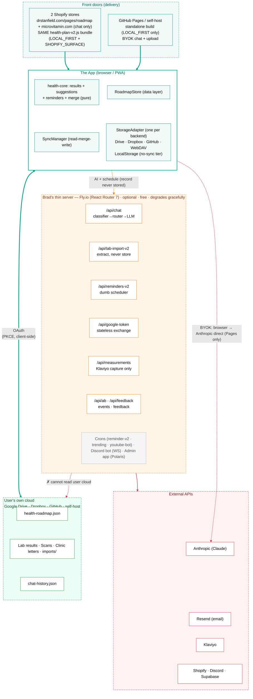
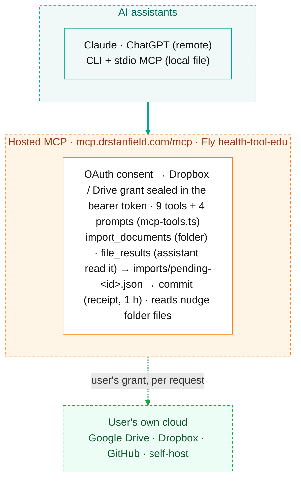

# Health by Dr Brad — Architecture (v2, local-first)

Last updated 2026-09-29. **Status: Live in production** — drstanfield.com serves the v2 local-first build on `/pages/roadmap`; microvitamin.com has no roadmap page (`/pages/roadmap` answered 404 on 2026-09-29) and runs the chat bubble alone, in brand posture. Whether microvitamin.com gets a roadmap page is Brad's open decision. The thin server runs React Router 7 on Fly (`v361+`). As of the **§12 split (2026-06-24)** the tool runs on **two domains / two Shopify apps / two Fly apps from one codebase & one widget bundle**: `drstanfield.com` is the **education** store (app `shopify.app.edu.toml`, Fly `health-tool-edu`) and `microvitamin.com` is the **commerce** store (app `shopify.app.toml`, Fly `health-tool-app`). This page and its parts are the single source of truth for v2 architecture. The legacy v1 shape and migration log live in **git history**. See [the reference](reference.md#document-import-decisions) for retained rationale and how to retrieve retired designs.

**What changed in one sentence:** the user's health data moved out of Brad's Supabase and into the *user's own cloud* (Google Drive / Dropbox / GitHub / self-host) as plain JSON files — Brad now stores no health record and can't read the user's cloud (what the server does keep, such as chat text for 30 days and a scrubbed copy of each health question with no end date: [privacy-and-data-path.md](architecture-v2/privacy-and-data-path.md#thin-server)).

**What this document is:** a single visual map of how the v2 app fits together — the three build flavours, the local-first storage spine, the merge engine, the cloud backends, the thin server that survives, and the data path that never touches Brad's server except through the hosted connector, which reads the record in memory for one request and stores none of it.

**What it isn't:** a changelog or a build log. It captures architectural *shape* as it exists in code today. For the dated *why* behind each decision and the step-by-step migration record, read the git history; for agent-facing build/deploy instructions, see [CLAUDE.md](../CLAUDE.md).

**Companion — the product spec:** [user-stories.html](user-stories.html) is the user-perspective catalogue (35 stories: acceptance criteria, usage evidence, test status). This page answers *how the system works*; that one answers *what it must do for users*. Every feature or bug fix starts from a story there — the story-driven development pathway (Lane A fixes / Lane B new features) is codified in [CLAUDE.md → Development Pathway](../CLAUDE.md). Grounding data: [the 2026-08 usage audit](usage-audit-2026-08.md) and the weekly reports in `docs/loops/`.

**New features must declare their usage signal before code is written.** Every new story states which `product_events` funnel event (or existing metric) will prove people actually use the feature — the weekly product-health report then shows its adoption numbers and forces an explicit iterate-or-kill decision. This rule exists because the reminders feature was built without one and sat at 2 total opt-ins for months with nobody noticing. A feature that can't be measured can't be evaluated.

> **Accuracy note.** This map was reconciled against the actual code at HEAD, not just the older design docs. Where the two diverged, code wins — those corrections are called out inline (e.g. the Pages build config is `vite.config.standalone.ts`, not a "pages" config; the Shopify build swaps *only* the storage module; crons self-start on import).

## Parts of this document

This page holds the Overview. The other sections live in one file per part, in the original order:

- **Overview** (this page) — [Introduction](#intro) · [The big idea](#big-idea) · [System diagram](#system) · [Front doors × storage](#front-doors) · [Tech stack](#stack)
- **[Client architecture](architecture-v2/client-architecture.md)** — [Builds & flags](architecture-v2/client-architecture.md#builds) · [Module-swap mechanism](architecture-v2/client-architecture.md#module-swap) · [Local-first storage spine](architecture-v2/client-architecture.md#storage) · [Merge & conflict model](architecture-v2/client-architecture.md#merge) · [Cloud backends](architecture-v2/client-architecture.md#backends) · [Identity / auth](architecture-v2/client-architecture.md#identity)
- **[Privacy & data path](architecture-v2/privacy-and-data-path.md)** — [The data path](architecture-v2/privacy-and-data-path.md#data-path) · [Brad's thin server](architecture-v2/privacy-and-data-path.md#thin-server) · [Honest positioning](architecture-v2/privacy-and-data-path.md#positioning)
- **[Features](architecture-v2/app-features.md)** — [Chatbot (server vs BYOK)](architecture-v2/app-features.md#chatbot) · [Lab upload](architecture-v2/app-features.md#lab-upload) · [Reminders v2](architecture-v2/app-features.md#reminders) · [Lead capture (Klaviyo)](architecture-v2/app-features.md#lead-capture) · [A/B · blog · bots](architecture-v2/app-features.md#ab-blog-bots)
- **[Server & data](architecture-v2/server-and-data.md)** — [API endpoints](architecture-v2/server-and-data.md#api) · [Crons](architecture-v2/server-and-data.md#crons) · [Supabase today + purge](architecture-v2/server-and-data.md#supabase)
- **[Ops](architecture-v2/ops-deployment.md)** — [Deployment topology (2 stores)](architecture-v2/ops-deployment.md#deployment-topology) · [Dev → prod pipeline](architecture-v2/ops-deployment.md#pipeline) · [Education / commerce split](architecture-v2/ops-deployment.md#edu-store) · [Deployment](architecture-v2/ops-deployment.md#deploy) · [Security model](architecture-v2/ops-deployment.md#security)
- **[Reference](architecture-v2/teardown-rejected-gotchas.md)** — [v1 → v2 teardown](architecture-v2/teardown-rejected-gotchas.md#migration) · [Rejected paths](architecture-v2/teardown-rejected-gotchas.md#rejected) · [Dangerous gotchas](architecture-v2/teardown-rejected-gotchas.md#gotchas)
- **Product** — [User stories ↗](user-stories.html) · [Usage audit (2026-08) ↗](usage-audit-2026-08.md) · [Loop fleet ↗](loops/loop-master-architecture-explanation.md)

## The big idea: local-first, user-owned cloud

v1 was a custodial app: Brad's Fly backend held a per-user JWT, wrote every measurement to Brad's Supabase, and RLS gated the rows. v2 inverts that. The valuable part of the product — `calculateHealthResults()` and the suggestion engine in [packages/health-core](../packages/health-core/) — already ran entirely client-side. So the data can too.

#### Interpretation is the product

Google Health and Microsoft HealthVault died as passive vaults. The recommendation engine — not the database — is the product. The engine stays free and client-side; the reminder loop fixes the empty-vault abandonment problem.

#### Brad is not the custodian

Removing Brad as data holder sheds the privacy and HIPAA-custody burden, and preserves the guarantee that the app *works even if Brad goes dark*. The data path never reaches Brad's servers.

#### The grandma test

Every choice is stress-tested against a 70-year-old non-technical user who will never run a server, use a terminal, or store a recovery phrase. This is why there is *no client-side encryption by default* (a forgotten key = lost history forever) and why Dropbox is the recommended backend.

## System diagram

The end-to-end v2 picture. The thick teal path — browser ↔ the user's own cloud — is the entire data layer, and it never crosses into Brad's infrastructure. Brad's thin server (orange) is optional and only handles things that genuinely need a server: AI calls he pays for, and the reminder scheduler.

The hosted MCP path, drawn as a second diagram so the first stays readable (its green box is the same user's own cloud as above):

Thick teal = the data path (app ↔ user's cloud), all client-side, never touching Brad. Orange dashed = optional thin-server AI + scheduling (the record transits and is never stored; chat text is kept 30 days, or longer on YouTube, and a scrubbed copy of each web health question with no end date, per privacy-and-data-path.md). Red = the server explicitly cannot read the user's cloud; on the Pages build, AI calls go browser→Anthropic direct with the user's own key. Second diagram: the hosted MCP reaches the user's cloud only with the grant the user gave at consent, per request; Brad's server keeps no user's cloud credential. The one exception: while an app review is pending, it holds the Dropbox credential of one invented reviewer account.

### Trust boundaries (v2)

- **Browser** — holds the powerful cloud OAuth token and (on Pages) the user's Anthropic key. Both live in `localStorage`/`sessionStorage` on the device only and are never synced or sent to Brad.
- **User's cloud** — the system of record. Folder-scoped access (the app can only touch files it created). Brad has no credential for it.
- **Brad's thin server** — trusted but deliberately starved of health data. It sees AI request content in memory (the record never stored; chat question text kept as privacy-and-data-path.md lists), the user's record during a hosted-MCP tool call (with the user's own grant, sealed in the bearer token, never at rest), and a reminder's *due date + label + verified email + capability token* — never the values or reasoning behind them.
- **Supabase** — holds operational data only, not the health record. That includes chat text as privacy-and-data-path.md lists, which is not anonymous: blog-bubble and embed rows carry a signed-in customer's `user_id`, Discord rows the author's `external_id`, YouTube rows the channel name. It also holds A/B and product events, `feedback_submissions` (email, message, customer id), reminder rows (email, labels, due dates) and `profiles` (a signed-in customer's email and first and last name). RLS is deny-all; the service-role key lives in Fly secrets. No health tables remain populated.

## Front doors × storage (two independent choices)

The single most clarifying idea in v2: **where the app is served** and **where the data is stored** are orthogonal. The same React app, built two ways, pairs with any of five storage backends.

### Delivery (front door)

- **Two Shopify stores** — the same theme extension on both: the tool on `drstanfield.com/pages/roadmap` (education); only the chat bubble on **microvitamin.com** (commerce, no roadmap page, Brad's open decision). The mainstream door; AI runs on Brad's server (free to the user). Each store is a separate Shopify app + Fly app but serves the *identical* widget bundle — see [deployment topology](architecture-v2/ops-deployment.md#deployment-topology).
- **GitHub Pages / self-host** — the same app, statically hosted. The "works if Brad goes dark" door; AI is bring-your-own-key. Also the primary dev/test surface.

### Storage (where the file lives)

- **Dropbox** — recommended default (true refresh token, App-folder scope).
- **Google Drive** — `drive.file` scope; needs the token-exchange endpoint.
- **GitHub** — fine-grained PAT, one repo (advanced/dev).
- **Self-host** — WebDAV + Basic auth (the only provider-proof option on iOS).
- **This browser only** — `localStorage`, no sync (guest tier).

## Tech stack

#### Client (the app)

- React 18 + TypeScript, Vite
- Two v2 entry points: `standalone/app.tsx` (local-first widget)
- Shared logic in `@roadmap/health-core` (the only workspace CI tests)
- Storage adapters talk to Drive/Dropbox/GitHub/WebDAV via fetch + PKCE
- Sentry browser SDK + ErrorBoundary

#### Server (thin, optional)

- React Router 7 on `node:22-alpine`, two Fly.io apps from one image — `health-tool-app` (commerce/microvitamin) + `health-tool-edu` (education/drstanfield), iad, 1 machine min each
- `@shopify/shopify-app-react-router` — app proxy + HMAC for the AI endpoints; Shopify Admin API `2026-04`
- Anthropic: Claude Sonnet 5.5 answers chat (streamed to the web as NDJSON) and routes; Haiku 5.5 (thinking off) classifies and extracts labs; 1-hour prompt cache (pins in `packages/health-core/src/models.ts`)
- Supabase (chat history + A/B only), Resend (reminders + ops digests), Klaviyo (email list)
- discord.js gateway; admin app on **Polaris web components** (not Polaris React)

### Server runtime — the RR7 migration (live)

The thin server was migrated **Remix 2.x → React Router 7** (Shopify's recommended path: `@shopify/shopify-app-react-router` + `react-router@7`, `shopify-api@13`, `session-storage-postgresql@6`, `@sentry/react-router`). The client widget never imported Remix, so the migration touched only `app/`: `json()` sites became `Response.json()` / `data()`, `RemixServer`→`ServerRouter`, and the admin UI moved off Polaris React onto Polaris web components. Shopify Admin API is on `2026-04`. RR7 is live in production (Fly `v361+`).

> **Danger —** **HIPAA scrub must survive the Docker image without the workspace.** Sentry init runs in a root `instrument-scrub.mjs` loaded via `node --import` *outside* the bundle, so it cannot import the PHI-redaction helpers from `@roadmap/health-core` — `.dockerignore` excludes `node_modules/` and `dist/`, and nothing rebuilds health-core's `dist` in the image, so that import would crash the server on boot and take HIPAA scrubbing down with it. The file is therefore a self-contained plain-ESM copy (`COPY . .`, relative import, zero workspace/dist dependency), guarded by a 4-test parity suite (`instrument-scrub-parity.test.ts`) that fails CI if it drifts from health-core's `sentry-scrub.ts`.

> **Danger —** **Risky server deploys must use `--strategy canary`, not the default rolling deploy.** The RR7 cutover crashed on boot (a transitive `@supabase/realtime-js` bump hard-threw on Node 20's missing native WebSocket; local Node 22 hid it). Fly's default *rolling* deploy + health checks did **not** protect against a boot crash — it updated *both* machines to the broken image and took production down. Recovery was `fly deploy --image <prev>`; the fix was `node:20-alpine` → `node:22-alpine`, redeployed via `fly deploy --strategy canary` (a throwaway canary machine is health-checked first, leaving the serving machines untouched if it fails).

---

This is the single source of truth for v2 architecture. The reasoning behind each decision and the dated migration build log live in the repo's git history (the former `health-roadmap-v2.html` decision record and `health-roadmap-v2-implementation.html` build log were consolidated here and deleted on 2026-06-15). For agent-facing build/deploy instructions and the full gotcha list, see [CLAUDE.md](../CLAUDE.md).
