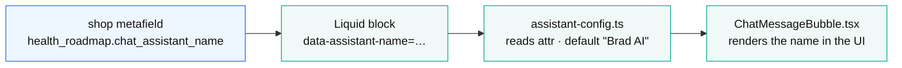
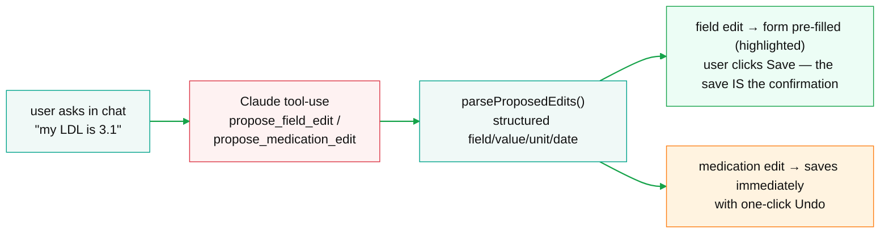
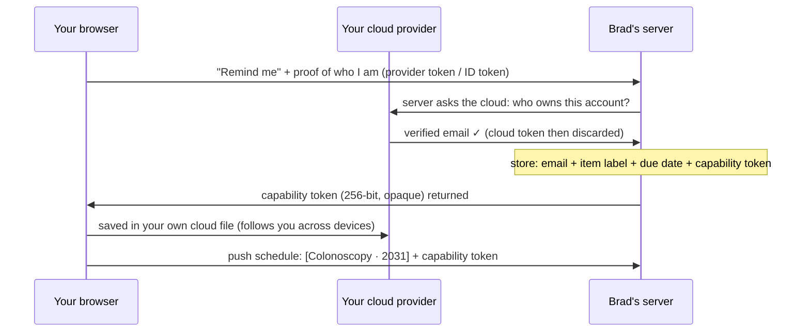

# Features

Part of [Health by Dr Brad — Architecture (v2, local-first)](../architecture-v2.md).

## Chatbot — server-proxied vs BYOK

The same chat UI, two transports chosen at build time. The Shopify build keeps `chat-api.ts` (app proxy → Brad's server, Brad pays). The Pages build swaps in `byok-chat.ts` (browser → Anthropic direct, user pays). Both send the user's plan as context — the data still comes from the local file, not a server lookup.

### Per-store assistant display name

The assistant's display name is **per-store**, driven by a shop metafield so the same bundle reads differently on each storefront. Default is **"Brad AI"**.

drstanfield (education) → "Brad AI"; microvitamin (commerce) → "MicroVitamin". Set per-store as a shop metafield; the widget bundle is identical — the name is data, not a build flag.

### Data-editing via tool-use (the chatbot can pre-fill the form)

The chatbot can now **propose edits to the user's roadmap** using Anthropic tool-use, on *both* the server (storefront) and BYOK (Pages) paths. The tool definitions live in [health-core/chat-edits.ts](../../packages/health-core/src/chat-edits.ts) — `propose_field_edit` (a measurement/profile field) and `propose_medication_edit` — and the parsed intent (`parseProposedEdits()`) carries structured field / value / unit / date, never fuzzy text.

No health data is ever auto-committed for measurements: the widget pre-fills the real form, highlighted, and the user's **Save** is the confirmation. Medications save immediately with Undo. Negatives are guarded — a bare number prompts for a unit; a wildly out-of-range value asks to confirm; a normal question fires no edit. Covered by a dedicated tool-use harness (`tools/test-tool-edits.ts`, fixtures `tools/test-tool-edits.json`) plus a no-spend self-consistency check in `chat-edits.test.ts`.

#### Server pipeline (storefront)

- [chat-classifier.server.ts](../../app/lib/chat-classifier.server.ts) — short-circuits \~59% of turns past the router
- [chat-router.server.ts](../../app/lib/chat-router.server.ts) — Sonnet 5.5 retrieval over the 1,024-entry blog index (prompt-cached, 1 hour), returns 0–3 content handles
- [chat.server.ts](../../app/lib/chat.server.ts) — context assembly, system blocks, `getChatCompletion`, titles
- [platform-chat.server.ts](../../app/lib/platform-chat.server.ts) — reuses the pipeline for Discord + YouTube
- Client: [chat-api.ts](../../widget-src/src/lib/chat-api.ts) sends the `LOCAL_FIRST` flag so the server treats the user as a guest-with-context, and `stream: true` for an NDJSON reply (status, sources, thinking and text lines, then `done`; US-15 AC16, AC20)

#### BYOK path (Pages)

- [byok-chat.ts](../../widget-src/src/lib/byok-chat.ts) — direct to `api.anthropic.com`, compact prompt grounded in the user's own data (the server's full system prompt + algorithm doc + KB routing are held-back IP and never shipped to a public bundle)
- [byok-anthropic.ts](../../widget-src/src/lib/byok-anthropic.ts) — shared browser→Anthropic transport
- Key `hr_anthropic_key` in `localStorage`, this device only, never synced

Training capture: *only* the storefront server chat is written to Supabase (anonymized). The BYOK/self-host chat is browser→Anthropic and is never sent to Brad.

## Lab upload

PDF text/image extraction is client-side (the `health-upload.js` pdf.js + JSZip bundle, loaded on demand). Only the extracted *text* goes to an LLM. The extraction prompt lives in [health-core/lab-extraction.ts](../../packages/health-core/src/lab-extraction.ts) and is imported by *both* the server route and the BYOK path so the two transports can't drift.

- **Storefront** — [/api/lab-import-v2](../../app/routes/api.lab-import-v2.ts), behind the app-proxy HMAC, per-IP + hard per-machine daily caps, nothing stored. The path: `UploadModal.tsx` runs pdf.js in the browser → the text goes to lab-import-v2 → `ReviewTable.tsx` shows every value against the record (conflicts held, not overwritten) → one bulk save into the file.
- **Pages** — [byok-upload.ts](../../widget-src/src/lib/byok-upload.ts), browser → Anthropic with the user's key, a client-side queue (concurrency 2) in place of the Batch API.
- **The files themselves** are kept and organised in the user's own cloud (v1 discarded them): AI classifies each into Lab results / Scans / Clinic letters / Other documents, named `YYYY-MM-DD Title.ext` so alphabetical sort is chronological. Content-hash dedup; nothing overwritten. A file the connector already imported metadata-only (hash, no `fileRef`) is recognised on re-upload, and Save archives the original behind that existing row (`archive-payloads.ts`, US-13 AC1).

## Reminders v2

Email-only, free, and website/server-only (no calendar/.ics, and it doesn't run on raw self-host, which has no provider-verified identity). The client computes forward due dates and pushes them; the server is a dumb scheduler holding no health data.

The email is *provider-verified*, never client-typed — the only address anyone can target is their own. Two tokens, never interchanged: the powerful cloud token stays on the device; a per-subscription capability token (stored raw, because the unsubscribe link must carry it) controls only the reminder schedule. A daily cron emails what's due; one-click unsubscribe (RFC 8058) deletes the row.

Route [api.reminders-v2.ts](../../app/routes/api.reminders-v2.ts); cron [reminder-v2-cron.server.ts](../../app/lib/reminder-v2-cron.server.ts) (lock `reminder_v2_cron`); table `reminder_optin_v2`. Group cooldowns: screening 90 d / blood test 180 d / medication review 365 d. The vocabulary is "opt-in", never "subscription" (which means paid products in this business).

## Lead capture — Klaviyo + client-side PDF

The "Get Your Personalized Plan" button does **exactly two things**: (1) the email address goes to Klaviyo, (2) a PDF is built client-side. No health data reaches any server; there is no Resend report email.

- **Client** — the shim's `sendGuestReport(email,…)` POSTs only `{klaviyoCapture:{email}}`; the PDF (`getReportHtml` → print window) is built first, inside the click's user activation. Gated to `SHOPIFY_SURFACE` — never fires on Pages.
- **Server** — [api.measurements.ts](../../app/routes/api.measurements.ts) is gutted to a single survivor, `handleKlaviyoCapture`: validates `{email}` only, rate-limited 5/day/email, calls `subscribeToKlaviyo` (email-only, no profile properties), stores nothing.
- **One Klaviyo account (Brad, 2026-09-28).** Both Fly apps hold the same `KLAVIYO_API_KEY` / `KLAVIYO_LIST_ID` pair: every roadmap-guest email, from either store, joins the **microvitamin** Klaviyo list `TpwCKK` "Health Roadmap Guests" and gets its "EP - Roadmap Guests" flow. The drstanfield Klaviyo account (list `R5nrgP`, set up 2026-06-25) is shut down; its `KLAVIYO_DR_BRAD_*` pair in `.env` is unused. **[by decision; the per-app split of 2026-06-25 was reversed]**
- **One-time flag** — on capture, `markReportEmailCaptured()` sets `profile.reportEmailCaptured` in the user's own file. On return, the email box never reappears; instead an inline **"Save as PDF"** button renders in the "Your plan to discuss with your doctor" header (the same slot the logged-in print button used). The flag rides whole-profile LWW — a concurrent cross-device edit at the exact capture moment could drop it, but it's monotonic and low-stakes (the box reappears once; Klaviyo dedups).

## A/B testing · blog/trending · bots

#### A/B testing

[app.ab-testing.tsx](../../app/routes/app.ab-testing.tsx) dashboard, [api.ab.ts](../../app/routes/api.ab.ts) events and `ab-stats.ts` remain. Admin permits one active test per target and writes a shop metafield, but the current `app-block.liquid` renders fixed copy without reading it. [Current wiring and historical rationale](../reference.md#ab-testing).

#### Blog / trending

The chat knowledge base is `docs/blog/` + `docs/guideline/` (third-party pathways removed 2026-10-22, US-15 AC39), indexed by `scripts/rebuild-blog-index.ts` into `index.json`. [trending-cron](../../app/lib/trending-cron.server.ts) writes trending articles to a metafield. The "supplement wiki" is `type:"reference"` articles with a +5 ranking boost in `chat.server.ts` — content, not infrastructure.

#### Discord / YouTube

[discord-bot.server.ts](../../app/lib/discord-bot.server.ts) runs a gateway WebSocket; [youtube-bot.server.ts](../../app/lib/youtube-bot.server.ts) auto-replies to comments. Both reuse the chat pipeline via `platform-chat.server.ts` (shared prompt cache).
