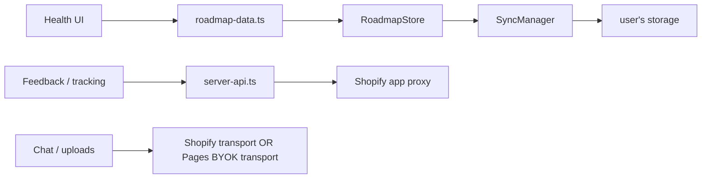
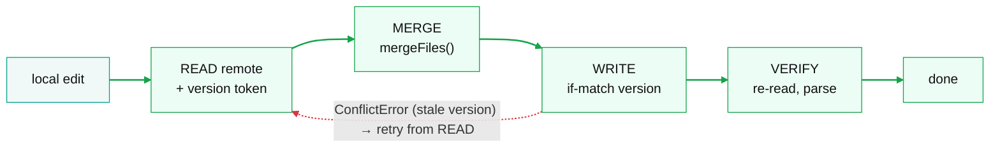

# Client architecture

Part of [Health by Dr Brad — Architecture (v2, local-first)](../architecture-v2.md).

<a id="builds"></a>
## Builds & flags

One source tree produces three bundles. Behaviour differences come entirely from two compile-time flags plus Vite module swaps — **never runtime sniffing**. The flags are declared in one place, [widget-src/src/lib/build-flags.ts](../../widget-src/src/lib/build-flags.ts), and injected by each config's `define`.

```ts
// build-flags.ts — the one place these are defined
export const LOCAL_FIRST    = import.meta.env.VITE_LOCAL_FIRST === 'true';
export const SHOPIFY_SURFACE = import.meta.env.VITE_SHOPIFY_SURFACE === 'true';
```

| Build | Command (root `package.json`) | Vite config | Flags | Output | Module swaps |
|---|---|---|---|---|---|
| **Shopify prod v2**<br>**Status: live** | `npm run build:shopify-prod` | [vite.config.shopify-prod.ts](../../widget-src/vite.config.shopify-prod.ts) (+ upload build) | `LOCAL_FIRST` + `SHOPIFY_SURFACE` | `health-plan-v2.js` + lazy `…-HistoryPanel.js` + `.css` → extension assets | None; explicit local data imports |
| **GitHub Pages / self-host** | `npm run build:pages` | [vite.config.standalone.ts](../../widget-src/vite.config.standalone.ts) (+ upload build) | `LOCAL_FIRST` only | `dist-pages/`, base `/roadmap/`, sourcemaps on | `chat-api.ts→byok-chat.ts`, `upload-api.ts→byok-upload.ts` |
| **Legacy v1** **Status: RETIRED 2026-06-15** | *deleted* (was `npm run build:widget`) | *deleted* (`vite.config.ts` + entry `src/index.tsx` removed) | — | `health-tool.js` deleted from assets | — |

> **Build ownership.** The Pages config is `vite.config.standalone.ts`; build commands live in the root package. Shopify uses Brad's chat/upload transports. Pages replaces only those AI transports with BYOK; no build substitutes the health-record data module.

> **Flag semantics.** `LOCAL_FIRST` tells the shared chat transport that health context comes from the browser. `SHOPIFY_SURFACE` gates Brad-server features such as email capture and product events. The main data layer is local-first on both builds without a flag or module substitution. Account-era form and report branches have been removed.

<a id="module-swap"></a>
## Explicit data imports; Pages-only AI transport swaps

Every health-record caller imports [roadmap-data.ts](../../widget-src/src/lib/roadmap-data.ts) directly. TypeScript checks the same data API that the bundle executes. The retired server CRUD implementation and its Vite redirect were removed on 2026-09-07.



The local data module owns reads, writes, record lifecycle, reminder schedule computation and client-side report generation. Its Shopify-only `sendGuestReport(email)` submits the address and computed reminder calendar, never health measurements. [server-api.ts](../../widget-src/src/lib/server-api.ts) owns proxy parsing, feedback and A/B/product tracking. `document-format.ts` owns display labels and date formatting.

Only the Pages build redirects `chat-api.ts → byok-chat.ts` and `upload-api.ts → byok-upload.ts`. Both builds use the same explicit local record API.

<a id="storage"></a>
## Local-first storage spine

Three layers: a pure data model + merge engine in `health-core` (so CI exercises the correctness-critical code), a browser I/O shell in `widget-src/src/storage/`, and one store the UI talks to.

#### Pure (health-core)

- [roadmap-file.ts](../../packages/health-core/src/roadmap-file.ts) — the `RoadmapFile` schema + `createEmptyFile`, `stableStringify`
- `merge.ts` — `mergeFiles()`: deterministic, symmetric, conflict-free
- `migrate.ts` — `migrateFile()` + `SchemaTooNewError` (normalise untrusted reads; forward-compat gate)
- `adapter.ts` — the `StorageAdapter` interface every backend sits behind; `memory-adapter.ts` — the in-memory two-devices-one-cloud test double
- `file-adapter.ts` — a `StorageAdapter` over one local file (Node `fs`, lock + backup), used by the CLI and local MCP server
- `roadmap-doc.ts` — `health-roadmap.json` as a `DocumentSpec`, shared by the widget and the hosted MCP server so both migrate/merge the record identically
- `document-path.ts` — the organised-archive folder+filename scheme for uploaded documents
- `lab-catalog.ts`'s `labSlotKey()` — normalises a lab name to its merge-dedup slot key
- `erase.ts` (the erased record), `record-session.ts` (change detection, erase identity, session timings), `storage-self-test.ts`, `record-host.ts` (what a client gives the engine) — the record engine the widget's store and the iPhone app share (ios/architecture.md D4); `engine-portability.test.ts` keeps them free of DOM and Node

#### Shell (widget-src/storage)

- `dropbox.ts` / `drive.ts` / `github.ts` / `webdav.ts` / `local-storage-adapter.ts`
- `web-record-host.ts` — the web's `RecordHost` (health-core `record-host.ts`): localStorage is the device tier; any other store is a cloud with localStorage as its mirror and the pending-sync marker
- `pkce.ts`, `device-id.ts`, `chat-history-store.ts`

### The `RoadmapFile`

One JSON file per user. Append-only arrays are never mutated; corrections add a row and flip the prior one to `entered-in-error` with a `correctsId` (the same FHIR `Observation` semantics v1 enforced in Postgres, now enforced in the file). Singletons (profile, screenings) carry a per-record logical clock.

```
{
  schemaVersion: 1,
  meta:    { createdAt, updatedAt, lastDeviceId, lamport, eraseEpoch },
  profile: { sex, birthYear, birthMonth, heightCm, unitSystem, unitOverrides,
             reportEmailCaptured?,        // monotonic Shopify-surface lead flag
             updatedAt, lamport },
  measurements:  [...],   medications/medicationHistory,
  supplements/supplementHistory,  screenings,  labValues: [...],
  documents:     [ { id, title, type, date, fileRef, contentHash, extractedText, … } ],
  reminderPreferences, reminderOptIn?,  recommendationSnapshots: [...]
}
```

- **`meta.lamport`** — file-level logical clock, bumped to `max+1` on every write.
- **`meta.eraseEpoch`** — added after a real bug: "Delete All My Data" silently failed because the never-lose-data merge union resurrected deleted rows. A higher `eraseEpoch` now wins `mergeFiles` wholesale. `RoadmapStore.deleteUserData()` bumps it.
- **`profile.reportEmailCaptured`** — set once when a user submits their email for the PDF, or signs up for reminders on a gate-skipped page (US-44 AC3); survives load→migrate (object spread) and merge (whole-profile LWW). See [lead capture](app-features.md#lead-capture).
- **Published for agents** — six surfaces over the same file. The contract: [health-roadmap-file.schema.json](../health-roadmap-file.schema.json) (JSON Schema draft 2020-12, pinned to `roadmap-file.ts` by `roadmap-file.schema.test.ts`) and [agent-access.md](../agent-access.md) (US-29). The CLIs: `tools/get-plan.ts`, which turns the file into the plan offline, no server, no model (US-30), and `tools/edit-record.ts` for contract-enforcing writes (US-31). The servers: `tools/mcp-server.ts`, a local stdio MCP over a file path (US-32 phase 0), and the hosted stateless server (`app/routes/mcp.$.tsx` + `app/lib/mcp*.server.ts`, US-32 phase 1), live at `mcp.drstanfield.com/mcp` on `health-tool-edu` since 2026-09-02 over Dropbox and Google Drive (the `GOOGLE_DRIVE_CLIENT_ID` / `GOOGLE_DRIVE_SECRET` secrets sit on that Fly app; the consent screen offers both). Both servers expose the eight tools in `packages/health-core/src/mcp-tools.ts` (`read_record`, `get_plan`, `add_measurement`, `add_lab_values`, `correct_value`, `update_profile`, `report_feedback`, `import_documents`) and four prompts. `import_documents` (US-35, since 2026-09-04) reads lab files from the Dropbox app-folder root (`Apps/Health Plan by Dr Brad`) or a file dropped into ChatGPT on a desktop browser, sends them to Anthropic for extraction, parks the candidates as `imports/pending-<id>.json` in the user's own folder, and writes nothing until a commit carrying the receipt (the pending file's UUID, 1 h). On a Google Drive record it refuses: `drive.file` cannot see files the user drops in, so it points to the website upload. Telemetry is value-free: `product_events` rows `mcp_connect` / `mcp_tool_call` / `mcp_import` carry tool, client, provider, file count, phase and route only. Pending (decided 2026-09-07, design in progress): assistant-side extraction becomes the default, so the server-side extraction leg above is due to change. Demo: `demo-video/` (Remotion). Map and trust model: [mcp-architecture.md](../mcp-architecture.md).

### The store + sync

[RoadmapStore](../../widget-src/src/storage/roadmap-store.ts) owns the local record operations exposed by `roadmap-data.ts`, including: `getPrefillInputs()` (synchronous profile seed so a returning user's "Starting Info" renders collapsed on first paint), `getReportEmailCaptured()/markReportEmailCaptured()`, `getReminderOptIn/setReminderOptIn/computeReminderScheduleNow`, and `flush()/flushSync()`. `app.tsx` awaits `initRoadmapStore` before render.

The [SyncManager](../../packages/health-core/src/sync-manager.ts) runs one optimistic-concurrency loop per named document — `health-roadmap.json` and `chat-history.json` ride the same loop via injected `DocumentSpec`s (filename + migrate + merge). After every write it re-reads and confirms the file parses and `lamport` hasn't regressed — catching half-writes and corruption at the cost of one extra read per save (invisible on an app used a few times a year).

<a id="merge"></a>
## Merge & conflict model

Two devices editing the same cloud file must converge without losing data and without a CRDT library. The model is append-dominant, so the merge is simple and deterministic:

- **Measurements & lab values** — slot-keyed by `(metric, day)`; at most one `active` row per slot; `entered-in-error` is monotonic (never reverts).
- **Current-state singletons** (profile, screenings, reminder prefs) — per-key last-write-wins by logical clock. **Wall-clock is only a tiebreak**, so two devices with skewed clocks still converge.
- **Logs** (medication/supplement history) — unioned. **Snapshots** — deduped. **`eraseEpoch`** — highest wins the whole file.



Every write merges against the freshest read. Backends with conditional writes (Dropbox `rev`, GitHub `sha`, WebDAV ETag) raise a `ConflictError` on a stale token and the loop retries. Google Drive has no conditional write, so both Drive adapters read the file `version` before the bytes and re-check it just before the upload, raising `ConflictError` if it moved; only the one-PATCH check-to-upload gap remains, and verify-after-write catches that.

<a id="backends"></a>
## Cloud backends

| Backend | Auth | Scope | Conflict token | Notes |
|---|---|---|---|---|
| **Dropbox** **[default]** | OAuth PKCE, real refresh token (pure client-side) | App folder (`Apps/Health Plan by Dr Brad`) | `rev` | Recommended — refreshes without a server. |
| **Google Drive** | Code-flow + refresh via [/api/google-token](../../app/routes/api.google-token.ts) (stateless); GIS popup fallback | `drive.file` (only files it created; the folder is `Health Plan by Dr Brad`, and the connector cannot see files the user drops there) | none → LWW | Exchange endpoint is the only place the client secret lives; it stores nothing. OAuth app must be *published* or refresh tokens die in 7 days. |
| **GitHub** | User-pasted fine-grained PAT | One repo, Contents r/w (+ Email read for reminders) | blob/commit `sha` | Token endpoints aren't CORS-enabled, so PKCE is impossible — dev/advanced tier. \~1 MB document cap. |
| **Self-host** | WebDAV + Basic auth | Whatever the user's server exposes | ETag / `If-Match`; `If-None-Match: *` on the first create | Needs server CORS: allow Authorization, Content-Type, Depth, If-Match and If-None-Match; expose ETag. The only provider-proof path on iOS. A server with no ETags degrades to LWW. |
| **This browser** | none | `localStorage` | version counter | Key `health_roadmap_file_v2`; documents as data-URLs (\~5 MB cap). The guest tier — the full app runs end-to-end with no cloud through the same SyncManager path. |

<a id="identity"></a>
## Identity / auth

v1's three-layer auth (Shopify HMAC → per-user JWT → Supabase RLS) is gone from the data path. In v2, **identity is the cloud account**: the browser does client-side OAuth (PKCE) directly with Google/Dropbox, and Shopify login is irrelevant to where data lives. The cloud token never leaves the device. One exception, on both builds: Google grants a refresh token only to a confidential client, so the browser posts the OAuth code to `api.google-token`, which forwards it to Google with our client secret and stores nothing.

The server-side HMAC app-proxy verification still exists, but only as an *anti-abuse front door* on the AI endpoints (chat, lab-import-v2) and the Klaviyo capture — see [Security model](ops-deployment.md#security). It is no longer how the app knows who you are.
