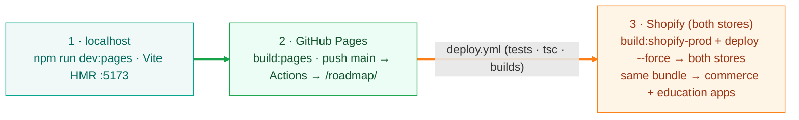
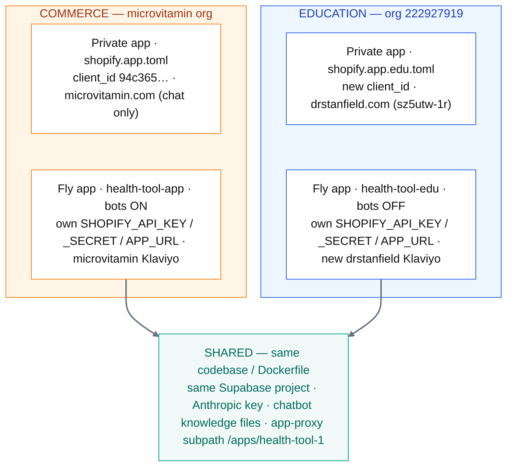

# Ops

Part of [Health by Dr Brad — Architecture (v2, local-first)](../architecture-v2.md).

## Deployment topology — two domains, two apps, one bundle

The **§12 split went live 2026-06-24.** The Health by Dr Brad tool now runs on **two storefronts** from **one codebase and one widget bundle**. Each storefront is a separate Shopify app registration and a separate Fly app, but the prod-built widget extension deployed to both is byte-identical — per-store behaviour comes from shop metafields and per-Fly-app secrets, never from a forked build.

|  | Education | Commerce |
|---|---|---|
| **Domain** | `drstanfield.com/pages/roadmap` | `microvitamin.com` (chat bubble; `/pages/roadmap` is a 404) |
| **Shopify app config** | `shopify.app.edu.toml` (org 222927919) | `shopify.app.toml` (client_id 94c365…) |
| **Fly app** | `health-tool-edu` | `health-tool-app` |
| **Widget bundle** | `health-plan-v2.js` — **same prod build deployed to both** | same bundle (one cell spanning both columns in the source table) |
| **Bots (Discord / YouTube)** | **Status: off** — bot tokens omitted | **Status: on** — only commerce runs the bots |
| **Chatbot display name** | "Brad AI" (default) | "MicroVitamin" |
| **Klaviyo** **[shared]** | microvitamin Klaviyo, list `TpwCKK` (drstanfield account shut down) | microvitamin Klaviyo, list `TpwCKK` |

#### Shared across both Fly apps

- Same **Supabase project**, Anthropic key, and chatbot knowledge files (the KB is Brad-global / store-agnostic).
- Same Postgres session store (`SESSION_DATABASE_URL`), same app-proxy subpath `/apps/health-tool-1`.
- The auth path (single-secret HMAC) is byte-identical across both apps.

#### Diverges per Fly app (secrets / metafields)

- `SHOPIFY_API_KEY` / `SHOPIFY_API_SECRET` / `SHOPIFY_APP_URL` — each app's own.
- **Bot tokens** — set on commerce only; the edu Fly app omits them, so only commerce runs the Discord/YouTube bots.
- **Klaviyo** — one shared `KLAVIYO_API_KEY` / `KLAVIYO_LIST_ID` pair on both apps: the microvitamin account, list `TpwCKK`. **[Brad, 2026-09-28: the drstanfield account is shut down]**
- **Chatbot name** — per-store shop metafield `health_roadmap.chat_assistant_name` (see [chatbot](app-features.md#chatbot)).

> **Stale-naming note (corrected here).** Earlier revisions of this doc called `drstanfield.com` "the production / commerce surface." After the §12 split that is **wrong**: `drstanfield.com` is the *education* store (Fly `health-tool-edu`); `microvitamin.com` is the *commerce* store (Fly `health-tool-app`). The Fly app name `health-tool-app` is still the commerce/microvitamin app despite the historical "production" framing.

## Dev → production pipeline

Two Shopify apps now — **commerce** (`shopify.app.toml`, Fly `health-tool-app`, store microvitamin.com) and **education** (`shopify.app.edu.toml`, Fly `health-tool-edu`, store drstanfield.com / `sz5utw-1r`). The earlier separate dev app and `/pages/test` were deleted. The promotion ladder is three tiers; pushing `main` auto-deploys Pages only. The live widget and both Fly apps change only through `.github/workflows/deploy.yml` (Actions → Deploy → Run workflow, or the Tier 3 auto-ship dispatch): gate → Pages WebKit smoke → `test:all` → `tsc --noEmit` (widget-src + health-core) → builds → Sentry sourcemaps → Shopify ×2 → Fly ×2 (canary) → health gates → live WebKit verify.

localhost is for non-OAuth work only — it is **never** an approved OAuth origin (hard rule). OAuth flows are tested on the github.io surface. The Shopify deploy needs `shopify app config use shopify.app.toml` first (the active config drifts), and the success banner must read `health-roadmap-<N>`.

## Education / commerce split — two app instances, not a second tenant

Brad's **education** Shopify store (`sz5utw-1r.myshopify.com`, served at `drstanfield.com`, in the **"Dr Brad Stanfield" org 222927919** — a *different* org than the commerce/microvitamin store) runs the same Health by Dr Brad tool. The chosen shape (**Option B**) runs it as a **separate private app + separate Fly app** from the *same codebase*, rather than turning the commerce server into a multi-tenant host.

**The decision in one sentence:** deploy the same Docker image a second time as `health-tool-edu`, pointed at a *new* private Shopify app registered in org 222927919, so the commerce auth path stays byte-identical and the live microvitamin.com roadmap cannot be affected by anything the education store does (and vice versa).

Two app registrations (two `client_id`s, two TOML variants) and two Fly apps built from one image. They diverge only in their Shopify credentials and URLs; everything in the data/AI path is shared.

### What's separate, what's shared

### Separate (per store)

- A new **private custom app** (its own `client_id`) registered in org **222927919**, kept as a new config variant [`shopify.app.edu.toml`](../../shopify.app.edu.toml) — the production `shopify.app.toml` (`94c365…`) is **never overwritten**.
- A second Fly app `health-tool-edu` from the *same* Dockerfile, with its **own** `SHOPIFY_API_KEY` / `SHOPIFY_API_SECRET` (the new app's), its own `SHOPIFY_APP_URL` / app-proxy URL.
- **Bots are commerce-only.** The edu Fly app *omits* the Discord + YouTube bot tokens, so only the commerce app (`health-tool-app`) runs those gateway/poller bots — the edu app boots without them.
- **Klaviyo is shared.** Both Fly apps set the same `KLAVIYO_API_KEY` / `KLAVIYO_LIST_ID`: the **microvitamin** Klaviyo, list `TpwCKK`. The drstanfield Klaviyo account (list `R5nrgP`) is shut down. **[Brad, 2026-09-28]**
- **Chatbot display name is per-store** via the `health_roadmap.chat_assistant_name` shop metafield (drstanfield → "Brad AI", microvitamin → "MicroVitamin"). See [chatbot](app-features.md#chatbot).
- **Order scopes are kept** on the edu app (`read_orders` + `read_all_orders`) so the chatbot's order-lookup path works there too.

### Shared (Brad-global)

- The **same Supabase project**, Anthropic key, and chatbot knowledge files — the chatbot's knowledge base is store-agnostic, so it works on the education store unchanged.
- The **same Postgres session store** (`SESSION_DATABASE_URL` is identical on both Fly apps), so each store's offline OAuth session (`offline_<shop>` row in `shopify_sessions`) lives in one table. `unauthenticated.admin(domain)` resolves the right token by shop domain.
- The **app-proxy subpath** `/apps/health-tool-1` is *reused*, so the existing widget build — which hardcodes `PROXY_PATH = '/apps/health-tool-1'` in [`widget-src/src/lib/server-api.ts`](../../widget-src/src/lib/server-api.ts) — works on the edu store with no rebuild.

> **Per-store crons on a shared Supabase.** Both Fly apps run the same in-process `setInterval` crons (they self-start on module import). The [trending cron](../../app/lib/trending-cron.server.ts) targets the store named by the per-app secret `SHOPIFY_SHOP_DOMAIN` (prod falls back to `microvitamin.myshopify.com`; edu is set to `sz5utw-1r.myshopify.com`) and writes that store's `health_roadmap.trending_articles` shop metafield. Because the apps *share* Supabase, they would otherwise contend for the single `trending_cron` row in `cron_lock` — only one store's metafield would be written per day. So the cron picks its lock name by shop: prod uses `trending_cron`, edu uses `trending_cron_edu` (both seeded in [`rls-policies.sql`](../../supabase/rls-policies.sql)). The edu store is new, so its trending payload is empty `[]` until it accrues ≥7d of landing-page sessions — the storefront's "Trending" sidebar has a graceful empty state.

> **Why a second app, not one multi-tenant server.** The auth path is single-secret HMAC verification ([`app/shopify.server.ts`](../../app/shopify.server.ts) / `route-helpers.server.ts` / `local-first-route.server.ts`). A second app instance keeps that code **byte-identical**, so the live commerce (microvitamin.com) roadmap cannot be touched by the education store, and vice versa. The alternative — one server resolving a per-shop secret at request time — was rejected: it rewrites the most safety-critical code on the live path for a store that doesn't need shared infrastructure.

## Deployment

- **Pages:** `npm run build:pages` → commit + push `main` → GitHub Actions publishes `drbradstanfield.github.io/roadmap`. (A `dev` branch builds to a `/dev/` subpath, best-effort.)
- **Shopify widget:** `shopify app config use shopify.app.toml` → `npm run build:shopify-prod` → strip `*.map` → `npx shopify app deploy --force`. Verify the success banner names the app you INTENDED (prod `health-roadmap-<N>`, not the education app).
- **Backend:** CI is the primary path (see [pipeline](#pipeline)). Manual fallback: from repo root, `fly deploy --strategy canary` per app (`docs/deploy-runbook.md`). `docs/products.md` is a real tracked file here since 2026-08-10, so there is no symlink to dereference. Use canary for any risky change — the default rolling strategy does not protect against a boot crash (see [gotchas](teardown-rejected-gotchas.md#gotchas)).

Rollback: there is **no JS rollback bundle**. The legacy `health-tool.js` was retired on 2026-06-15 (bundle, entry, and config deleted), and even before deletion it was a dead end — its `api.ts` fetch functions targeted server endpoints and Supabase tables that the v2 teardown removed/purged, so re-pointing `app-block.liquid` at it would load a non-functional, data-less zombie. A genuine rollback now means reverting the v2 teardown commits and rebuilding the v1 stack from git history.

## Security model

- **AI endpoints behind HMAC.** `/api/chat` and `/api/lab-import-v2` verify the Shopify app-proxy signature (`verifyAppProxySignature()`, ±10-min replay window, stale-timestamp rejected before crypto) — a cryptographic front-door check curl can't fake. This superseded the forgeable Origin allow-list.
- **Confidentiality is the absence of a read path,** not the allow-list. No endpoint returns anyone's email; no list, lookup, or search exists. The Origin/CORS allow-list is anti-abuse only — and **localhost is never on it** (hard rule: a rogue local page must not be able to drive OAuth or server endpoints).
- **Rate limits + a hard daily $ cap** bound AI abuse cost; per-IP limits + a 10-min block on the opt-in endpoint.
- **Two tokens, never interchanged** (reminders): the cloud token stays on the device; the capability token controls only reminder dates.
- **BYOK key hygiene:** the user's Anthropic key is `localStorage`-only, never synced; strict CSP and no `innerHTML` of untrusted content; users are advised to use a spend-limited key.
- **Supabase** RLS is deny-all; the service-role key lives only in Fly secrets. Secrets are env-only and gitleaks-scanned in CI.
