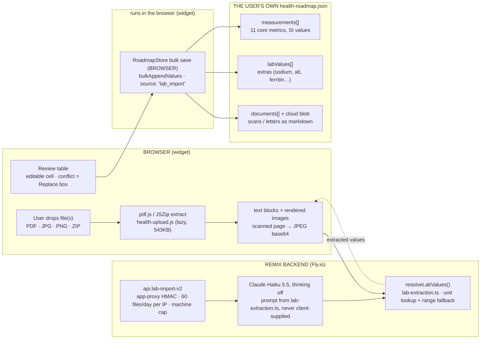
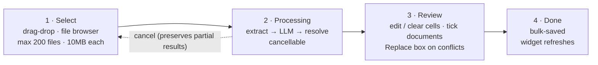
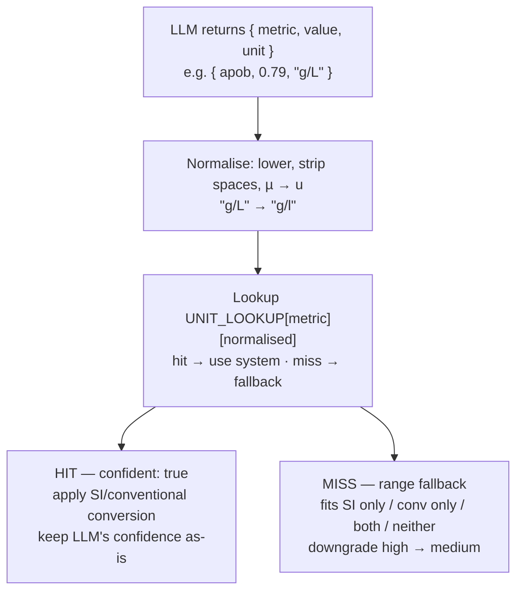

# Lab Upload — how it works

*Architecture overview · Extraction pipeline (v2 local-first, audited against the code 2026-09-07)*

Users drag a lab PDF/image/ZIP into the widget. Claude Haiku calls extract target metrics in parallel, the server resolves units to SI, the user reviews and (optionally) edits each value before bulk-saving. Saved values are correctable via a FHIR `replaces` pattern — original values are preserved as `entered-in-error`, never overwritten.

- **Shipped:** v341 (March 2026, initial) · redesign May 2026 — commits `052ada1`, `5ab25ad`, `8f428cb`, `0f795d7`, `6a56814`, `2bce3bf`
- **Companion docs:** [docs/lab-upload.md](lab-upload.md) (implementation detail) · [docs/lab-upload-connector.md](lab-upload-connector.md) (the assistant route)
- **Status:** Shipped

> **Note:** v2 status banner added 2026-06-13.

> **Read this first · v2 local-first is now live**
>
> Since the **2026-06-12 production cutover**, `/pages/roadmap` serves the v2 **local-first** build (`health-roadmap-727`); the Supabase widget is kept only as a rollback asset. §§1 and 7–10 describe the live v2 behaviour. Anything still naming a Supabase table, an RPC, or an HTTP status code — the appendix trace, parts of §11 — is **historical v1** and labelled as such.
>
> **What changed (the extraction/review/FHIR-correction pipeline itself is unchanged):**
>
> - **Storage** — extracted values *and* the original files are written to the **user's own cloud** (Google Drive / Dropbox / GitHub / self-host) as plain JSON + archived documents, not Supabase. Corrections use the same `entered-in-error` + `correctsId` shape, now applied *in the file* (not the `correct_measurement` RPC).
> - **Endpoint** — extraction goes to `app/routes/api.lab-import-v2.ts` via the Shopify app proxy (`/apps/health-tool-1/api/lab-import-v2`), authenticated by an **app-proxy HMAC signature** (`verifyAppProxySignature()`), not the old `api.lab-import.ts` (deleted) or an `AI_ALLOWED_ORIGINS` Origin allow-list (superseded).
> - **Upload conflicts** — an uploaded value that disagrees with a saved one (usually written by a connected assistant through the MCP connector) is shown as a conflict with an unchecked **Replace** box, never dropped and never auto-applied — [§9](#conflict), US-32 AC24.
> - **BYOK option** — the GitHub Pages / self-host build runs extraction **browser → Anthropic direct** with the user's own key (`byok-upload.ts`); no Brad server in the path.
>
> Current architecture map: [architecture-v2.md](architecture-v2.md) · live behaviour detail: the **"v2: Local-first lab uploads"** section of [lab-upload.md](lab-upload.md).

> **Customer report — a customer (a physicist) · the failure that prompted the redesign**
>
> "Health Roadmap parsed my Apo-B incorrectly. It parsed **0.79** from the PDF, but the PDF states **0.5 g/L**. I tried to explain to the AI that this value was incorrect, but the AI could not change it. Therefore it kept giving me advice centred around this (very important) marker, which was completely wrong for me."
>
> **Resolution shipped:**
> **Edit at review** inline-edit the value cell before save (caught the bug at the strongest moment).
> **Click-to-correct** click any saved value to fix it (FHIR replaces — original preserved as `entered-in-error`).

**Contents**

1. [1 · End-to-end data flow](#flow)
2. [2 · Performance: parallel extraction + LLM workers](#perf)
3. [3 · Upload modal state machine](#states)
4. [4 · LLM extraction contract](#contract)
5. [5 · Unit resolution decision tree](#units)
6. [6 · Confidence semantics](#confidence)
7. [7 · Storage map (the local-first file)](#storage)
8. [8 · Corrections — review-edit + click-to-correct](#corrections)
9. [9 · Upload conflicts — the document vs. the record](#conflict)
10. [10 · FHIR invariants (status, correctsId, one active row)](#schema)
11. [11 · Design decisions (post-ship)](#decisions)
12. [12 · The connector route and a proposal that is NOT built](#connector)

<a id="flow"></a>
## 1 · End-to-end data flow

Two trust zones: the browser (file parsing, review, and **all storage**) and the Remix backend (LLM proxy + unit resolution). Raw PDFs never leave the browser — only extracted text or page images are sent to the LLM, and the backend never persists them. **Since the 2026-06-12 local-first cutover the save path has no server in it at all:** reviewed values go into `RoadmapStore` and sync to the user's own cloud.



The three right-hand boxes are arrays in the user's own `health-roadmap.json`, not server tables. The bulk-save box sits in a browser-coloured strip: it runs in the widget, the backend never sees a save. The prompt and unit resolution live in `packages/health-core/src/lab-extraction.ts`, imported by the server and the BYOK build alike. The dashed return arrow carries `{ metric, valueSI, displayValue, displayUnit, confidence, question? }`.

<a id="perf"></a>
## 2 · Performance: parallel extraction + LLM workers

The widget runs a producer/consumer pipeline (`processPipeline()` in `UploadModal.tsx`). **3 parallel pdf.js extractors** feed a queue; **5 LLM workers** drain it. Wall-clock for a 12-file ZIP drops from \~50s (concurrency 1) to \~12s (the longest-LLM-call + queue drain). Verified live in Chrome DevTools: max 5 concurrent `/api/lab-import-v2` calls in flight.

**Shipped: 3 extractors + 5 LLM workers in parallel**

EXTRACT_CONCURRENCY=3, LLM_CONCURRENCY=5 in UploadModal.tsx. Extractors keep the queue feeding 5 LLM workers without UI jank.

*Drawn as a timeline chart on an axis marked 0s · 5s · 10s · 15s · 20s · 25s (0s at x=80, 25s at x=900). Each file has an "extract" bar and an "LLM call" bar; the bars are drawn one after another — each file's LLM call starts where the previous file's ends. Raw bar x-ranges below. The bars date from the earlier "pipelined, concurrency 1" version of this chart (commit 60ed42c2); only the title and subtitle were updated for the shipped 5-worker design, so the bars show the old serial schedule, not the shipped one.*

| File | extract bar (x-range) | LLM call bar (x-range) |
|---|---|---|
| File 1 | 80–135 | 135–300 |
| File 2 | 135–190 | 300–465 |
| File 3 | 190–245 | 465–630 |
| File 4 | 245–300 | 630–795 |

Bracket under the bars, from 0s to the end of File 4's LLM call: **total ≈ 25s for 4 files**

`LLM_CONCURRENCY = 5` + `EXTRACT_CONCURRENCY = 3` in `UploadModal.tsx`. The producer is a worker pool over a shared `extractIndex` (safe on single-threaded JS); the consumer is `tryStartWorker()` draining the queue with up to 5 LLM calls in flight.

### Why 5 + 3

- **Anthropic Build Tier 2 cap.** 80K output tokens/min. Lab-report extraction emits \~500–1,500 output tokens per call (scan/letter markdown conversion is the worst case at \~4K). 5 concurrent calls × 1.5K avg ≈ 7.5K/min — comfortable.
- **Extraction parallelism unblocks the pipeline.** pdf.js extraction is CPU-bound on the main thread (\~2–3s per file). With 1 extractor, LLM workers starve — they finish in \~5s but the next item isn't ready. 3 extractors keep the queue feeding 5 workers without UI jank.
- **Server-side retry.** `callAnthropic()` in `anthropic.server.ts` makes at most 2 HTTP attempts (flat 1 s) on 502/503/504/529 and network errors; `extractOrClassify()` wraps that in 2 outer attempts, each a call plus one re-send of the same request, sharing one deadline (no `{` prefill since 2026-10-16: Haiku 5.5 rejects it). The client never retries.
- **Verified in production:** 13-call upload on 12-file ZIP showed `maxConcurrent = 5` in DevTools timing (commit `052ada1`).

### A separate path: Anthropic Batch API for 20+ files

The widget routes uploads of `≥ BATCH_THRESHOLD` files through `processBatch()` → Anthropic Batch API instead of the interactive pipeline. This is **50% cheaper per call** but **async with up to 24h SLA** (typically minutes). Used for bulk historical imports (ZIP of a decade of lab reports), not the common 1–5 file case. Polled via `/api/lab-import-v2?batchId=<id>`; poll state is per Fly machine, a miss 404s and the client falls back.

<a id="states"></a>
## 3 · Upload modal state machine

Implemented in `widget-src/src/components/UploadModal.tsx`. Linear flow with one cancel path.



States are `'select' | 'processing' | 'review' | 'done'` in `UploadModal.tsx`. At review, every upload value is an editable input (D1); there is no per-value checkbox. A cell saves when its text is non-empty and clearing it skips the value. Documents have a checkbox. Save is offered even with nothing selected when the bytes match a connector-imported row ("Save 1 Original", §7).

<a id="contract"></a>
## 4 · LLM extraction contract

The system prompt is `unifiedSystemPrompt(mode)` in `packages/health-core/src/lab-extraction.ts`, imported by the server and the BYOK build; the document only ever rides in the user message, so a malicious PDF can't override it. One LLM call per file. Two modes: `'full'` (the website: classify, then extract lab values or convert the document to markdown, 12288 tokens) and `'metadata'` (the connector: title, date, one-line summary, 3072 tokens). Both target the same 11 core metrics.

### Target metrics (11)

`ldl` · `hdl` · `total_cholesterol` · `triglycerides` · `hba1c` · `creatinine` · `apob` · `psa` · `lpa` · `systolic_bp` · `diastolic_bp`

Anything outside this list goes to `additionalValues` (unified) or `unrecognized` (legacy).

### Critical rules in the prompt

1. Extract **measured values only** — never reference ranges or targets
2. If current + previous shown, take **only the most recent**
3. Use the **collection date**, not the print/report date
4. Ambiguous dates: `DD/MM/YYYY` for non-US labs, else low confidence
5. Uncertain values → `confidence: "low"` + a `question` string

### Output schema (after server-side unit resolution)

```jsonc
// per file, returned by /api/lab-import-v2
{
  "reportDate": "2024-11-21",
  "values": [
    {
      "metric": "apob",
      "valueSI": 0.79,           // saved to DB
      "displayValue": 0.79,      // what the LLM read
      "displayUnit": "g/L",
      "confidence": "high",      // LLM's self-rating
      "question": undefined
    }
  ],
  "additionalValues": [ /* sodium, ferritin, alt, … */ ],
  "unrecognized": [ "vitamin D: 45 ng/mL" ],
  "document": null                // non-null for scans, letters, etc.
}
```

<a id="units"></a>
## 5 · Unit resolution decision tree

The LLM returns a unit string like `"mg/dL"` or `"g/L"`. The backend converts to SI canonical via `resolveUnit()` in `packages/health-core/src/lab-extraction.ts`. The lookup table is built from `UNIT_DEFS` (auto-populated) plus a handful of manual aliases.



Note: the resolver only downgrades confidence on a lookup miss. A *lookup hit* always trusts the LLM's self-rating — including when the LLM misread the digit itself. This is the trust seam that the customer's case sits on.

### UNIT_LOOKUP for ApoB (today)

| Key | Maps to | Source |
|---|---|---|
| `g/l` | SI | auto from `UNIT_DEFS.apob.label.si` |
| `mg/dl` | conventional | auto from `UNIT_DEFS.apob.label.conventional` |
| `mg/dl` (alias) | conventional | manual `addAlias()` — redundant |

ApoB SI canonical = `g/L`, validation range `0–3`. Conventional = `mg/dL`, range `0–300`. So both `0.5 g/L` and `0.79 g/L` (and `50 mg/dL`, `79 mg/dL`) are in range — nothing here will catch a digit misread.

<a id="confidence"></a>
## 6 · Confidence semantics — what each label means today

| Level | Set when… | What the UI does with it |
|---|---|---|
| high | LLM self-rated "high" *and* the unit was a direct lookup hit | Plain editable cell. No `question` shown. |
| medium | LLM rated "medium", OR LLM rated "high" but unit was inferred via range fallback | Plain editable cell. `question` shown if present. |
| low | LLM rated "low" (ambiguous date, both current+previous visible, etc.) | Cell **highlighted** (`bt-cell-low-confidence`), `question` shown. Still saves unless the user clears it. |

Confidence is *advisory*, not gating. Nothing in the pipeline cross-checks the LLM against itself or against a second engine. Confidence comes entirely from the LLM's own introspection, which it is not particularly good at when the input is a low-resolution scanned PDF.

<a id="storage"></a>
## 7 · Storage map (the local-first file)

One upload writes into three arrays of the user's own `health-roadmap.json` — the file that lives in their Google Drive, Dropbox, GitHub or localStorage. There are no server tables and no save endpoint. FHIR `Observation` semantics are enforced in `RoadmapStore` + `merge.ts`: rows are never mutated except for the sticky `status` flip that a correction performs.

| Array | Receives | Shape highlights | Mutability |
|---|---|---|---|
| `measurements[]` | The core metrics — converted to SI canonical | `metricType`, `value` (SI), `recordedAt`, `source`, **`status`** (`'active'` \| `'entered-in-error'`), **`correctsId`** | **Status flip only** |
| `labValues[]` | Everything else numeric (sodium, ferritin, alt…) — stored as reported | `metricName`, `value`, `unit`, `referenceLow/High`, same `status`/`correctsId` pair | **Status flip only** |
| `documents[]` (+ the original blob) | Non-lab classifications (scans, clinic letters…) and the archived original file. A lab PDF gets a synthesized `pathology_report` row with `metadata.labArchive: true`, hidden from the Documents list. A connector import lands metadata-only: `fileRef: ''` + `contentHash`; the next website upload of the same bytes archives the blob into a new row and tombstones that one ("Save 1 Original") | `type`, `title`, `date`, `extractedText`, `metadata`, `fileRef`, `contentHash`, `sourceFileName`, `deleted` tombstone | **Tombstone-only** |

### `source` values

| Value | When it's used |
|---|---|
| `manual` | User typed into the form (default) |
| `lab_import` | LLM-extracted, not edited at review time — including a Replace that supersedes an existing row |
| `lab_import_edited` | LLM-extracted then user-corrected at review time |
| `manual_correction` | A post-save click-to-correct in the timeline |
| `apple_health`, `fitbit` | Future HealthKit-style imports |

**Dedup keys are stable, never LLM text.** Values slot on `(metric, day)` — one active row per slot. Lab extras slot on `labSlotKey(name)` + day, so "Gamma GT" and "ggt" collapse. Originals dedup on the file's **content hash**, with `sourceFileName` carried on the document row.

**What is *not* kept:** nothing at all on Brad's server — no PDF, no LLM response, no extracted text. In the user's own file we keep the SI value, the date, the `source`, the `status`, any `correctsId`, and (when they have a cloud connected) the original document itself.

<a id="corrections"></a>
## 8 · Corrections — review-edit + click-to-correct

Two surfaces let the user fix a wrong value, intervening at different moments:

### ① Edit at review time

In `ReviewTable.tsx`, each value cell is a numeric input (`type="text"`, `inputMode="decimal"`, locale-aware so `0,5` and `0.5` both parse). User types over the LLM's extraction before clicking **Save**.

- Edited rows save with `source: 'lab_import_edited'`.
- Unedited rows save with `source: 'lab_import'`.
- Catches the bug at the strongest moment: user is looking at the PDF and the extracted value side-by-side.

### ② Click-to-correct after save

In the blood-test matrix, every saved value is a clickable button (`bt-cell-clickable`). Clicking opens an inline edit form. Enter or click-away saves (if validation passes); Escape discards. Behind the scenes it is a local write:

1. `RoadmapStore` flips the old row's `status` to `entered-in-error`.
2. It appends a new active row with `source='manual_correction'` + `correctsId`, on the old row's date.
3. The file syncs to the user's cloud; merge keeps the flip sticky across devices.

No RPC, no 409/404 — the v1 wording described a server round trip that no longer exists.

### Re-uploading the same data

A slot that already holds an active row with the *same displayed value* is already recorded: the matrix greys it out as context and saves nothing. A *differing* value is a conflict — §9. The original file itself dedups on content hash, so re-uploading a PDF the archive already holds is a no-op.

<a id="conflict"></a>
## 9 · Upload conflicts — the document vs. the record

An upload can land on a `(metric, day)` slot that an active row already holds. The usual author of that row is a **connected AI assistant writing through the MCP connector**, which slots one value per metric per day the same way. v1 dropped the document's number and showed an "Already saved" badge; v2 shows the disagreement and lets the person settle it (**US-32 AC24**).

The review table is a date × metric matrix (`buildMatrixModel()` in `ReviewTable.tsx`). Each upload value meets whatever holds its cell:

| Slot state | What the reviewer sees | What saves |
|---|---|---|
| Free | An editable cell | A new active row, `source: 'lab_import'` (`'lab_import_edited'` if typed over) |
| Held, same value | Greyed context cell — "Already saved at this date" | **Nothing** the record already says this |
| Held, different value | **Conflict cell**: the saved value ~~struck through~~, the document's value in an editable input, and an **unchecked `Replace`** box | **Only if Replace is ticked** — the old row flips to `entered-in-error`, the new row appends with `correctsId` on the old row's date, `source: 'lab_import'` |

Equality is on the **quantity**, not the printed number: a core metric compares its stored SI value, a lab converts the saved and printed values to one unit (`sameLabQuantity`). So 50 ng/mL of vitamin D over a saved 50 nmol/L is a conflict, and float noise never makes one.

### Rules worth not overturning

- **Unticked means the existing value wins.** Silence is not consent to overwrite.
- **Nothing auto-supersedes on source rank.** A correction asserts the old value was *wrong*, and only a person can assert that. The connector's row is not automatically less trustworthy than the PDF, or more.
- **A "replacement" equal to what is saved writes nothing** — it would correct nothing.
- **A stale `correctsId`** (the row was superseded on another device between review and save) is skipped and counted in `skippedDuplicates`, never appended. Two active rows in one slot must not exist.

Tests: `ReviewTable.conflict.test.ts` (the conflict cell) · `roadmap-store-upload-conflict.test.ts` (the correction the store writes).

<a id="schema"></a>
## 10 · FHIR invariants (`status`, `correctsId`, one active row)

The v1 enforcement — Postgres grants, a `SECURITY DEFINER` `correct_measurement` RPC, two triggers and a partial UNIQUE index — went away with the tables on 2026-06-12. The invariants did not; they are now enforced in code, on the client.

| Invariant | Where it lives now |
|---|---|
| **Rows are never mutated** (except a sticky `status` flip) | Every writer goes through `RoadmapStore`; corrections append with `correctsId`. Non-browser writers (CLI, stdio MCP, hosted MCP) share the same `SyncManager`, so no path bypasses it. |
| **One active row per `(metric, day)`** | `bulkSaveMeasurements` / `bulkSaveLabValues` hold a taken-slot Set and skip anything that would double-fill it; a Replace supersedes exactly once. |
| **The flip survives sync** | `mergeFiles()` — `entered-in-error` is sticky, arrays are append-only, so two devices converge on the same active row. |
| **No revert to `active`** | Status is monotonic in both the store and the merge. A revert is not expressible. |

<a id="trace"></a>
## Appendix · Tracing the customer's ApoB failure (historical)

Pre-redesign trace. Steps 4 and 7 (the no-edit-path gaps that prompted the work) are now addressed by §8. Kept here for context on the motivating bug.

### 1 · PDF uploaded, page rendered to image

His lab report's ApoB row reads **0.5 g/L**. pdf.js sees a thin text layer (or none), falls back to canvas rendering at 1.5× scale, sends as JPEG base64.

File: `widget-src/src/lib/pdf-extract.ts`

### 2 · Claude Haiku 5.5 misreads the digit

**Highlighted as the step where the bug bites.**

Vision pass returns `{ metric: "apob", value: 0.79, unit: "g/L", confidence: "high" }`. The character "5" was misread as "79", or — more likely — Haiku picked up an adjacent value (a reference-range edge, a different row, a previous result). Both rules 1 and 2 in the system prompt warn against this, but the model is the only thing enforcing them.

File: `packages/health-core/src/lab-extraction.ts` (`UNIFIED_SYSTEM_PROMPT`) · model: `claude-haiku-5-5`

### 3 · Unit resolution: lookup hit

`norm("g/L") = "g/l"` → `UNIT_LOOKUP.apob["g/l"] = "si"` → `valueSI = 0.79`, `confident: true`. No fallback, no confidence downgrade.

File: `app/lib/anthropic.server.ts → resolveUnit() · ApoB SI range 0–3 (0.79 fits cleanly)`

### 4 · Review table renders value as read-only text

**Highlighted as a gap.**

Row shows `0.79 g/L` · high · checkbox pre-checked. The customer sees the wrong number on screen but has no input to fix it. He clicks Save anyway (or accepts the default), since the alternative is just not saving.

File: `widget-src/src/components/ReviewTable.tsx:428` — `<span className="review-row-value">`

### 5 · Bulk save

`POST /api/measurements { bulkMeasurements: [{ metricType: "apob", value: 0.79, recordedAt, source: "lab_import" }] }`. Row inserted into `health_measurements`. No `displayValue`, `displayUnit`, or confidence retained.

File: `app/routes/api.measurements.ts:353–385`

### 6 · Suggestion engine fires on 0.79 g/L

**Highlighted as a gap.**

ApoB 0.79 g/L is high; cascade suggests escalating lipid therapy. Suggestions render in the widget and in any reminder email.

File: `packages/health-core/src/suggestions.ts (ApoB-driven cascade)`

### 7 · User tells the chatbot "this is wrong"

**Highlighted as a gap.**

Chat has the value in `latestValues.apob = 0.79`. It can acknowledge the complaint but cannot write to `health_measurements` — there is no tool for that. It also has no way to know the value came from an upload (the `source` field isn't in chat context). So next turn, it keeps recommending based on 0.79.

File: `app/lib/chat.server.ts → assembleChatContext() · app/lib/chat-system-prompt.md`

### 8 · Only escape hatch: delete + re-enter

The customer's options are (a) delete the row from history then type 0.5 manually, or (b) accept the wrong value lives in his history forever. Neither was discoverable from his vantage point, so he emailed instead.

---

### Future interventions not in scope this round

- **Dual-OCR consensus.** Two Claude calls (or Claude + a vision-OCR specialist) with value-level agreement gating `confidence: high`. Rejected for this round (D4 below): meaningful cost (\~2× LLM spend), questionable ROI now that the user has two correction surfaces. Revisit if production correction frequency stays high.
- **Validation ranges as guard rails.** ApoB &lt; 0.3 or &gt; 2.5 g/L is rare enough to warrant a "double-check this" prompt. The threshold helpers in `units.ts` already encode the ranges — wiring them into the review UI is small.
- **Show the PDF page alongside the value** at review time. Strongest signal for digit-misread catches.
- **Chatbot write tool.** A `correct_measurement` tool exposed to the bot would let "that ApoB is wrong, it's 0.5" actually update the row. Opens a write surface that needs careful confirmation UX.
- **Provenance preservation.** Persist `displayValue`, `displayUnit`, model name, and a hash of the source PDF page so we can re-OCR with a better model when one ships.

---

<a id="decisions"></a>
## 11 · Design decisions (post-ship)

Load-bearing choices that future work should preserve unless deliberately overturning.

| Decision | Why | What overturning costs |
|---|---|---|
| **D1 · Inline-edit at review time** | Catches LLM digit misreads at the strongest moment — user sees the source PDF and the extracted value side-by-side. Edited rows tagged `lab_import_edited` for audit analytics. | Reintroduces the original "no way to fix wrong extractions" gap. Don't overturn. |
| **D2 · FHIR `replaces` for post-save corrections** | Append-only data; the only mutation is the sticky `status` flip. Old values preserved as `entered-in-error`; new values link via `correctsId`. Matches FHIR R4 `Observation` semantics and plays nicely with future EHR/Apple HealthKit export. (The v1 RPC that enforced this is gone — §10.) | Alternative was true-UPDATE (loses prior value) or delete-and-re-add (loses correction semantics). Either weakens the audit trail. |
| **D3 · Concurrency 5 LLM × 3 extractors** | Tier 2 absorbs 5 concurrent \~1.5K-token extractions. 3 parallel pdf.js workers keep the queue feeding the LLM workers without UI jank. | Bumping further hits Anthropic Tier 2's 80K/min output cap on scan-heavy uploads. Increasing extractor count hurts main-thread responsiveness. |
| **D5 · The reviewer settles an upload conflict** | An upload that disagrees with a saved value is shown, not dropped, and replaces only when the person ticks Replace. Ranking sources automatically would let a document silently overwrite what an assistant wrote, or the reverse. | Either a silent data loss (drop the document's number) or a silent overwrite. Don't overturn — US-32 AC24. |
| **D4 · No dual-OCR / second-engine consensus** | \~2× LLM spend; ROI unclear once users have two correction surfaces. Revisit if production correction frequency stays high. | Deferred, not rejected — see "Future interventions" above. |
| **Server-side system prompt** | Prevents prompt injection — a malicious PDF can't override extraction instructions because the content is in the user message, not the system prompt. | Security regression. Don't overturn. |
| **Never auto-save** | Health data, no exceptions. Every value passes through an explicit user confirmation step. | HIPAA + user-trust regression. Don't overturn. |
| **HMAC auth on every endpoint** | App-proxy convention. Any new endpoint (re-extract, correction) must follow the same pattern. | Security regression. Don't overturn. |
| **Server-side unit resolution** | Centralises all unit logic in `units.ts` + `lab-extraction.ts`. Client receives values ready to save. | Duplicated logic, more places to drift. Preserve. |
| **One LLM call per page-list** (no cross-file batching in the prompt) | Prevents cross-contamination between files from different dates/labs/patients. Simpler error handling — one file fails, others unaffected. | Save a few cents per upload, gain a tangled prompt and harder failure-mode reasoning. Preserve. |
| **Claude Haiku 5.5** (not Sonnet; Haiku 4.5 until 2026-10-16) | Structured parsing, not complex reasoning. \~$0.0004–0.0007 per report, thinking off. Vision support for scanned pages. | Swap model ID to Sonnet for \~20× cost if accuracy issues persist after other fixes. No code changes beyond the constant. |
| **No raw PDF storage** | Privacy-first. On the website route files never leave the browser; only extracted text/images reach the backend. The connector route sends the whole file through the server for one request; nothing is persisted on either route. | Storing PDFs opens HIPAA scope, S3 costs, encryption-at-rest requirements. Don't overturn lightly. |
| **Confidence is advisory, not gating** | Low-confidence cells are highlighted but still editable and still save — the user can clear them. The system never silently drops a value. | Switching to "gating" (refuse to display low-confidence values) would prevent some bad saves but force users to re-upload more often. Status quo treats the user as the final arbiter. |

<a id="connector"></a>
## 12 · The connector route, and a proposal that is NOT built

**Built (US-35, September 2026):** a user's own assistant calls `import_documents` on mcp.drstanfield.com. Brad's server fetches the file from the connected Dropbox folder, sends the whole file to the same Haiku pipeline in `'metadata'` mode with a 40 s budget, slots the values with the same `record-edits.ts` functions the website uses, parks the candidates in the user's folder and hands back a receipt (the pending file's id); a second call commits what the user confirmed. 5 files a call, 30 a day per connection, the machine cap shared with the website. Full detail: [lab-upload-connector.md](lab-upload-connector.md).

> **Proposed, not built · assistant-side extraction (7 September 2026)**
>
> The user's own assistant reads the file in its own context and calls the existing write tools with structured rows; our server validates and writes only. Pro: no health file transits Brad's server, no per-file model spend, no receipt machinery. Con: extraction quality and injection resistance become the assistant's, and there is no `contentHash` for the archive to key on. **Decision pending Brad; an adversarial review is in progress. Nothing in this diagram set describes it.** Detail: lab-upload.md, "Proposed, not built".

---

Canonical sources: `docs/lab-upload.md`, `docs/user-stories.md` (US-32 AC24, the upload conflict), `app/routes/api.lab-import-v2.ts` (the only endpoint an upload calls), `app/lib/anthropic.server.ts` + `packages/health-core/src/lab-extraction.ts` (extraction + unit resolution), `widget-src/src/storage/roadmap-store.ts` (bulk saves, supersede, document archive), `packages/health-core/src/{merge,roadmap-file,document-path,validation,units}.ts`, `widget-src/src/components/UploadModal.tsx` (pipeline + done-screen), `widget-src/src/components/ReviewTable.tsx` (matrix, inline-edit, conflict cell), `widget-src/src/lib/archive-payloads.ts` (archive policy, the Original path), `packages/health-core/src/record-edits.ts` (slot rule, `bulkAppendValues`), `app/lib/mcp-import.server.ts` + `packages/health-core/src/mcp-tools.ts` (the connector route).
