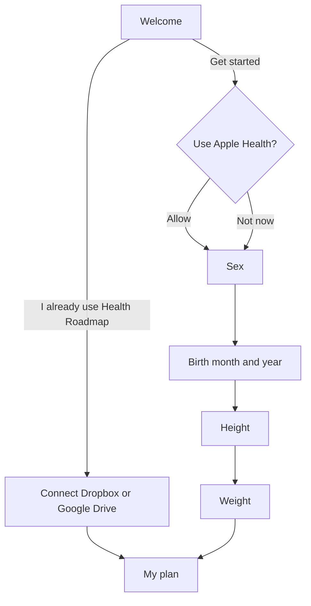

# iPhone app: onboarding (approved by Brad, 2026-10-22)

Status: **approved 2026-10-22, with every recommendation below** (Health's sex and birth
date read, weight optional, the "I already use it" path in the same build, App Store
Connect retention as the signal, existing users skip). The story is US-54 in
[docs/user-stories.md](../docs/user-stories.md); the code is `ios/HealthRoadmap/Onboarding/`.

## The problem

Today a new user sees one welcome screen, taps "Get started", and lands on the full My
data form. It has about thirty rows. Nothing says which ones the plan needs. A person who
fills in nothing gets "Your plan needs a few details" on My plan.

The plan runs on two things, sex and height (health-core's one `PlanError` asks for
them). Birth year adds age, which the screenings wait for. Weight makes the plan much
better. Everything else can come later.

## What Apple does

Apple Health's first run asks for "Health Details" (birth date, sex, height, weight) on
one short form, prefilled where it can, then gets out of the way. Apple Fitness asks the
same things one per screen, each with a large wheel, a progress indicator and one
Continue button. Both:

- ask only what they need, with one sentence on why;
- prefill anything the phone already knows;
- make every step skippable except what the feature cannot work without;
- end on the thing the person came for.

## The flow

1. **Welcome.** What the app does, that the record stays on the phone or in the person's
   own cloud, never on our server, and that it is education, not medical advice (today's
   AC10 text, shortened). Two ways on: **Get started**, and a smaller **I already use
   Health Roadmap**, which connects Dropbox or Google Drive and brings the existing
   record in, so a web user never types their details twice.
2. **Apple Health.** The only page before Apple's sheet: "Fill this in from Apple Health?",
   six tiles (sex, birth date, height, weight, waist, blood pressure) ticking in, one line
   on where what is read goes and that added values are saved back, and a hint for Apple's
   two taps. No switch of ours: Apple's sheet cannot be pre-switched. **Connect Apple
   Health** shows the sheet. **Not now** goes on. Either way the next screens come next.
3. **Sex.** Female or Male, two large buttons. One line on why: the plan's targets and
   screenings depend on it.
4. **Birth month and year.** Two wheels. We never ask for or keep the day.
5. **Height.** A wheel: centimetres, or feet and inches, by the phone's region, with a
   switch.
6. **Weight.** A wheel, in kilograms or pounds. **Skip** is offered.
7. **My plan.** The plan, straight away.

Each question screen:
- has a progress bar (4 steps), **Back**, and one **Continue** at the bottom;
- shows a value from Apple Health already selected, labelled "From Apple Health";
- saves on Continue through the engine's own writes (`updateProfile`, `appendMeasurement`),
  so a value the engine refuses shows its words and nothing is written.

Reminders, the cloud and lab upload are not part of onboarding. Each is offered where it
lives, the first time it matters.

## Draft story

### US-54 · A new iPhone user reaches their plan in under a minute

As a new app user, I answer four short questions, most filled in for me from Apple
Health, and see my plan, without facing the full form.

- **Usage signal:** see open question 4.
- AC1: a new user (no record values, onboarding not done) sees the flow above once.
  "Get started" leads to the Apple Health screen; the existing welcome rules hold
  (education, not advice; where the record lives).
- AC2: "I already use Health Roadmap" runs Sync's own connect (US-25 AC11). A record
  that already has sex, birth year and height skips the questions and opens My plan.
  One that lacks any of them asks only for those.
- AC3: Connect Apple Health on the Apple Health screen asks HealthKit for read access to sex, date of
  birth, height and weight. Values it returns preselect the matching screens. Sex
  "other" or "not set" preselects nothing. Of the birth date, only month and year are
  used; the day is never stored.
- AC4: each question is one screen with Back, Continue and a 4-step progress bar. Sex,
  birth month and year, and height are needed to continue. Weight has Skip.
- AC5: Continue writes through the engine (`updateProfile` for sex, birth year and
  month, height; `appendMeasurement` for weight, dated today, `source: apple_health`
  when it came from Health). A refused value shows the engine's words and stays on the
  screen.
- AC6: units default to the phone's region (US region: feet, inches, pounds) and are
  saved as the record's unit choice, which My data can change later.
- AC7: after the last step the app opens My plan. Quitting part way keeps what was
  saved, and the next launch resumes at the first unanswered question.
- AC8: VoiceOver reads every screen; Dynamic Type sizes keep Continue on screen.

## Open questions for Brad

1. **Birth date from Apple Health.** Reading sex and date of birth is a new HealthKit
   permission. The purpose text and the App Store privacy answers change. Worth it to
   save two taps? (Recommended: yes. It is the main point of the Allow screen.)
2. **Weight optional?** The plan runs without it, but the weight cascade and BMI need
   it. (Recommended: optional, with Skip.)
3. **The "I already use it" path.** It needs Google Drive or Dropbox sign-in to work on
   the phone first. Ship it in the same build? (Recommended: yes, Dropbox already
   works.)
4. **How we measure it.** The app sends no product events (D9), so we cannot count how
   many people finish onboarding. App Store Connect shows installs and retention only.
   Options: accept retention as the signal, or allow one counts-only event with no
   health value ("onboarding finished"), which changes D9. (Recommended: retention for
   now.)
5. **Existing testers.** People who already have values skip onboarding. Agreed?

## What changes in the code

- New: an `Onboarding` folder in the app (screens and a small step model).
- Changed: `RootView` decides between onboarding and the tabs; `WelcomeView` gains the
  second button; HealthKit read types gain sex and date of birth (purpose string).
- No change to health-core: the writes already exist. No clinical change, no merge or
  FHIR change.
- Tests: the step model (what to ask, resume, skip), the prefill mapping from HealthKit
  (sex other, no birth day kept), and a UI pass on the simulator and the iPhone.
