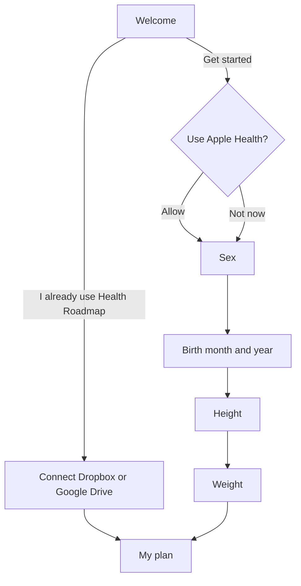

# iPhone app: onboarding (approved by Brad, 2026-10-22)

Status: **approved 2026-10-22, with every recommendation below** (Health's sex and birth
date read, weight optional (made required 2026-10-23), the "I already use it" path in the same build, App Store
Connect retention as the signal, existing users skip). The story is US-54 in
[docs/user-stories.md](../docs/user-stories.md); the code is `ios/HealthRoadmap/Onboarding/`.

## The problem

Today a new user sees one welcome screen, taps "Get started", and lands on the full My
data form. It has about thirty rows. Nothing says which ones the plan needs. A person who
fills in nothing gets "Your plan needs a few details" on My plan.

The plan runs on two things, sex and height (health-core's one `PlanError` asks for
them). Birth year adds age, which the screenings wait for. Weight makes the plan much
better. Everything else can come later.

## What Apple does

Apple Health's first run asks for "Health Details" (birth date, sex, height, weight) on
one short form, prefilled where it can, then gets out of the way. Apple Fitness asks the
same things one per screen, each with a large wheel, a progress indicator and one
Continue button. Both:

- ask only what they need, with one sentence on why;
- prefill anything the phone already knows;
- make every step skippable except what the feature cannot work without;
- end on the thing the person came for.

## The flow

1. **Welcome.** What the app does, that the record stays on the phone or in the person's
   own cloud, never on our server, and that it is education, not medical advice (today's
   AC10 text, shortened). Two ways on: **Get started**, and a smaller **I already use
   Health Roadmap**, which connects Dropbox or Google Drive and brings the existing
   record in, so a web user never types their details twice.
2. **Apple Health.** The only page before Apple's sheet: "Use your Apple Health data",
   six tiles (sex, birth date, height, weight, waist, blood pressure) ticking in, one line
   ("So you type less.") on where what is read goes and that added values are saved back.
   Just above **Connect Apple Health**, the last thing read before the tap, a small tinted
   callout gives Apple's two taps: **Turn On All**, then **Allow**. No switch of ours:
   Apple's sheet cannot be pre-switched. **Not now** goes on. Either way the next screens
   come next.
3. **Sex.** Female or Male, two large buttons. One line on why: the plan's targets and
   screenings depend on it. A tap saves and moves on; there is no Continue. A sex from
   Apple Health shows selected and still takes that one tap.
4. **Birth month and year.** Two wheels. One line on why: age decides which checks are
   due (bowel and breast cancer screening, bone density scans). We never ask for or keep
   the day.
5. **Height.** A large number box, focused on arrival: centimetres, or feet and inches
   (two boxes). A cm / ft in switch beside it starts from the record's units.
6. **Weight.** The same, in kilograms or pounds. Required (Brad 2026-10-23): no Skip.
7. **My plan.** The plan, straight away.

The unit switch is for entry only (review 2026-10-23): it never writes the record's
units, which come from the region default and change in My data › About you › Units.
A box left alone shows the record's value again in the new units; a typed one is
converted, through the engine (`convertJson`, health-core's factors). On Continue a typed
value is converted once to the units the engine's edit reads. A box filled from the
record and not typed in saves nothing, in any unit.

Each question screen:
- has a progress bar (4 steps), **Back**, and one **Continue** at the bottom (sex
  excepted: its tap is the answer);
- shows a value from Apple Health already selected, labelled "From Apple Health";
- saves through the engine's own writes (`updateProfile`, `appendMeasurement`), so a
  value the engine refuses shows its words and nothing is written.

Reminders, the cloud and lab upload are not part of onboarding. Each is offered where it
lives, the first time it matters.

## Draft story

### US-54 · A new iPhone user reaches their plan in under a minute

As a new app user, I answer four short questions, most filled in for me from Apple
Health, and see my plan, without facing the full form.

- **Usage signal:** see open question 4.
- AC1: a new user (no record values, onboarding not done) sees the flow above once.
  "Get started" leads to the Apple Health screen; the existing welcome rules hold
  (education, not advice; where the record lives).
- AC2: "I already use Health Roadmap" runs Sync's own connect (US-25 AC11). A record
  that already has sex, birth year and height skips the questions and opens My plan.
  One that lacks any of them asks only for those.
- AC3: Connect Apple Health on the Apple Health screen asks HealthKit for read access to sex, date of
  birth, height and weight. Values it returns preselect the matching screens. Sex
  "other" or "not set" preselects nothing. Of the birth date, only month and year are
  used; the day is never stored.
- AC4: each question is one screen with Back, Continue and a 4-step progress bar. Sex,
  birth month and year, and height are needed to continue. Weight has Skip (since
  2026-10-23 weight is required too; the live ACs are US-54's).
- AC5: Continue writes through the engine (`updateProfile` for sex, birth year and
  month, height; `appendMeasurement` for weight, dated today, `source: apple_health`
  when it came from Health). A refused value shows the engine's words and stays on the
  screen.
- AC6: units default to the phone's region (US region: feet, inches, pounds) and are
  saved as the record's unit choice, which only My data's Units row changes. The height
  and weight switches are for entry only.
- AC7: after the last step the app opens My plan. Quitting part way keeps what was
  saved, and the next launch resumes at the first unanswered question.
- AC8: VoiceOver reads every screen; Dynamic Type sizes keep Continue on screen.

## Open questions for Brad

1. **Birth date from Apple Health.** Reading sex and date of birth is a new HealthKit
   permission. The purpose text and the App Store privacy answers change. Worth it to
   save two taps? (Recommended: yes. It is the main point of the Allow screen.)
2. **Weight optional?** The plan runs without it, but the weight cascade and BMI need
   it. (Recommended: optional, with Skip. Brad, 2026-10-23: required.)
3. **The "I already use it" path.** It needs Google Drive or Dropbox sign-in to work on
   the phone first. Ship it in the same build? (Recommended: yes, Dropbox already
   works.)
4. **How we measure it.** The app sends no product events (D9), so we cannot count how
   many people finish onboarding. App Store Connect shows installs and retention only.
   Options: accept retention as the signal, or allow one counts-only event with no
   health value ("onboarding finished"), which changes D9. (Recommended: retention for
   now.)
5. **Existing testers.** People who already have values skip onboarding. Agreed?

## What changes in the code

- New: an `Onboarding` folder in the app (screens and a small step model).
- Changed: `RootView` decides between onboarding and the tabs; `WelcomeView` gains the
  second button; HealthKit read types gain sex and date of birth (purpose string).
- No change to health-core: the writes already exist. No clinical change, no merge or
  FHIR change.
- Tests: the step model (what to ask, resume, skip), the prefill mapping from HealthKit
  (sex other, no birth day kept), and a UI pass on the simulator and the iPhone.

## The tour (US-57, approved by Brad 2026-10-25)

After the last question the person lands on My plan, and a three-tip tour starts. It uses
Apple's TipKit, shows once and can be skipped. The story and its ACs are US-57.

1. **The snapshot** (the summary tiles): "Your numbers at a glance". Every tile opens a
   short explainer of what it is, for good, not only during the tour.
2. **The first Foundation step**: each step comes with its reason and its evidence.
3. **Blood tests, on My data**: the more you add, the more personal the plan; a lab
   report fills these in. Its action opens the lab upload sheet.

No cloud sign-up in the tour. One prompt after the person's third save offers to back up
the record to their own Dropbox or Google Drive. It shows once and opens the Sync sheet.

### Code

- `Onboarding/TourTips.swift`: the three tips, the tour's step (one TipKit parameter),
  `TourStep` (the pure order: close moves on, skip ends), `TourSetup` (`Tips.configure`
  at launch, and the launch arguments), and the `tourTip` modifier the anchors use.
- `Onboarding/CloudPrompt.swift`: the third-save rule (a count and a done flag in
  UserDefaults) and `CloudPromptView`, which opens the existing `SyncView`. Built in
  phase 1, not wired yet. Not named `*Backup*`: `.gitignore`'s `*backup*` would hide it.
- `Plan/TileExplainerSheet.swift`: a tile's "what it is" above its existing why. It
  replaces `SummaryTiles`' private `TileEvidenceSheet` in phase 2.
- Phase 2 wires the anchors (`PlanView`, `SummaryTiles`, `MyDataView`), starts the tour
  from `RootView.finishOnboarding`, and counts saves from `RecordStore`.

### Tile explainers: what exists, what is new

The web has no plain "what it is" text for its tiles. A tile's tap opens its evidence:
`STAT_CARD_EVIDENCE`, `getBmiEvidence`, `getIbwEvidence` and `getProteinEvidence` in
`packages/health-core/src/evidence.ts`, which `statTiles` (`stat-tiles.ts`) already hands
to the web's `ResultsPanel` and to the phone. That evidence is reused as is, below the new
words. `roadmap_text.html` explains the protein target in its body text but has no tile
text.

The new words are a short "what it is" for each tile key. Rule: no threshold and no
grading, so they suit a known minor's tile (US-07 AC6) and never disagree with the status
or the evidence beneath. Proposed home: a `STAT_TILE_ABOUT` map beside `statTiles`, served
as `StatTile.about` through `screenJson`, so the engine serves it and Swift holds no
clinical words. Not wired yet.

| Tile key | Draft "what it is" | Source in health_roadmap_algorithm.md / evidence.ts |
|---|---|---|
| `whtr` | Your waist measurement divided by your height. It shows how much weight you carry around your middle, which BMI cannot show. | § Waist-to-Height Ratio; `STAT_CARD_EVIDENCE.whtr` (central adiposity) |
| `bmi` | Body mass index: your weight in kilograms divided by your height in metres, squared. It cannot tell muscle from fat, so your waist measurement can change how the plan reads it. | § BMI, § Composite Assessment (WHtR reclassifies 25 to 29.9) |
| `ibw` | A healthy weight for your height and sex, from the Peterson formula (2016). The plan sets your protein target from it, not from your current weight. | § Ideal Body Weight; § Daily Protein Target |
| `protein` | How much protein to eat each day, set from your ideal body weight. Enough protein helps you keep muscle, more so after 40. | § Daily Protein Target; `getProteinEvidence` |
| `apoB` | Apolipoprotein B counts the particles in your blood that can build up in artery walls. The plan prefers it to the other cholesterol tests because it predicts heart risk most closely. | `STAT_CARD_EVIDENCE.apob`; `lipidMarkerFor` (ApoB, then non-HDL, then LDL) |
| `nonHdl` | Your total cholesterol minus your HDL cholesterol: the cholesterol in every particle that can build up in artery walls. The plan uses it when there is no ApoB result. | § Non-HDL (`totalCholesterol - HDL`); `STAT_CARD_EVIDENCE['non-hdl']` |
| `ldl` | The cholesterol carried by LDL particles, the main kind that builds up in artery walls. The plan uses it when there is no ApoB or non-HDL result. | `STAT_CARD_EVIDENCE.ldl`; `lipidMarkerFor` |
| `egfr` | Estimated glomerular filtration rate: how well your kidneys filter your blood, worked out from a creatinine blood test, your age and your sex. | `STAT_CARD_EVIDENCE.egfr` (CKD-EPI 2021) |
| `lpa` | Lipoprotein(a), a cholesterol particle whose level is set mostly by your genes. Diet and exercise change it little, so one test in a lifetime is usually enough. | `STAT_CARD_EVIDENCE.lpa` |
| `hba1c` | Your average blood sugar over the last two to three months, from one blood test. | `STAT_CARD_EVIDENCE.hba1c` |

**NEEDS BRAD:**
1. A known minor's BMI, lipid, Lp(a) and HbA1c tiles are not buttons today (US-07 AC6
   drops their why). "Every tile tappable" would let them open the "what it is" alone, with
   no why. The words carry no threshold. Allow it, or keep a minor's tiles as they are?
2. Do these words fall under the three-file sync? They add no rule or threshold, but they
   are health content shown to the person. If yes: a "Tile explainers" table in
   health_roadmap_algorithm.md, and roadmap_text.html needs nothing (it has no tile text).
3. `ibw`: the evidence says target BMI 24 (men) and 22 (women) is linked with the lowest
   all-cause mortality. The draft leaves that out and says only "a healthy weight". Keep it
   plain, or name the mortality link?
4. `egfr`: the draft does not say "higher is better", because a very high eGFR is not
   always good. Right to leave it out?
5. `protein`: "more so after 40" follows the evidence's "particularly important for adults
   over 40". Keep the age, or drop it?
